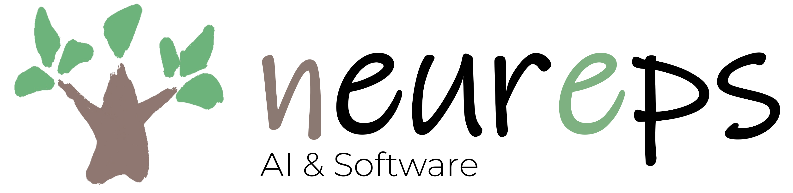

<p align="center">
  <a href="https://neureps.com">
    
  </a>
</p>

<p align="center">
  <a href="https://neureps.com"><b>neureps.com</b></a> ·
  <a href="https://neureps.com/support/">지원</a> ·
  <a href="https://neureps.com/privacy/">개인정보처리방침</a>
</p>

---

**주식회사 뉴렙스(Neureps Inc.)** 는 2026년 경기도 용인에서 시작한 소프트웨어 스타트업입니다. 일상에서 매일 쓰이는 모바일 앱을 직접 기획하고 개발하며, 머신러닝과 생성형 AI 기술을 제품에 자연스럽게 녹여내는 일을 합니다.

저희는 기술이 나무와 닮았다고 생각합니다. 좋은 자리에 심고, 꾸준히 돌보면, 어느 순간 사람들에게 그늘과 열매를 돌려줍니다. 뉴렙스라는 이름과 두 팔을 벌린 나무 로고에는 그렇게 오래 자라는 소프트웨어를 만들겠다는 다짐을 담았습니다.

첫 번째 앱 [온기(Warmly)](https://neureps.com/warmly/)를 출시했고, AI 음악 채널 [뉴렙스 뮤직(Neurepsic)](https://neureps.com/music/)을 함께 운영하고 있습니다. 작은 팀이지만, 만드는 것 하나하나를 끝까지 책임지는 회사가 되겠습니다.

이 저장소는 뉴렙스 공식 웹사이트([neureps.com](https://neureps.com))의 소스입니다.

## 로컬 수정과 검증

본문은 각 경로의 `index.html`에서 수정합니다. 공통 헤더·푸터는 `site/*.html.tmpl`,
회사 정보·번역·페이지별 메뉴는 `site/layout.json`이 정본입니다. 생성된 공통 영역을 직접 고치지 않습니다.
다른 언어로 이동하는 본문 링크에는 `data-lang="ko"` 또는 `data-lang="en"`을 지정합니다.

```sh
python3 tools/render_layout.py
python3 tools/render_layout.py --check
python3 tools/check_site.py
node --check assets/lang.js
node --check assets/warmly-banner.js
python3 -m http.server 8765 --bind 127.0.0.1
```

렌더러는 공통 영역과 CSS·언어 스크립트의 내용 해시를 반영한 캐시 버전만 갱신합니다.
HTML·CSS·스크립트를 수정한 뒤 렌더러를 실행하고, 결과 HTML도 함께 저장합니다.
배포 서버에서 빌드하거나 브라우저가 공통 HTML을 추가로 요청할 필요가 없습니다.

브라우저 회귀 검사는 Node.js, Playwright, 설치된 Chrome을 사용합니다. 별도 환경에 설치한
Playwright는 `NODE_PATH=/path/to/node_modules node tests/browser.cjs`로 지정할 수 있습니다.
`node tests/browser.cjs`는 임시 로컬 서버를 열어 언어 전환, 저장소 차단, 모바일 메뉴,
동작 줄이기와 반응형 레이아웃을 검사하고 서버를 종료합니다.
검증은 로컬에서만 수행하며 GitHub Actions를 추가하거나 실행하지 않습니다.

---

<p align="center">
  © 2026 Neureps Inc. · <a href="mailto:contact@neureps.com">contact@neureps.com</a>
</p>
